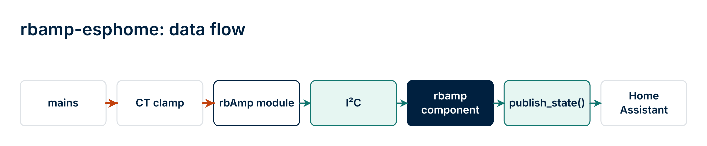
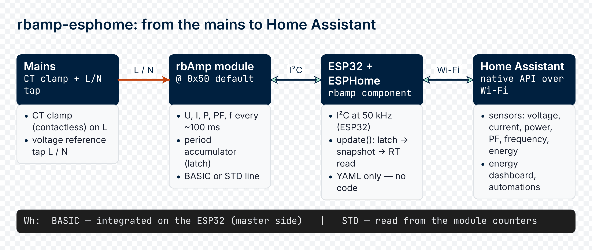
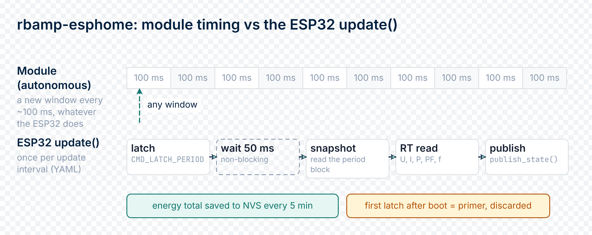

# 01 · Overview


## What rbAmp is

**rbAmp** is a compact hardware module for precision measurement of AC mains parameters. From an integrator's point of view it is an ordinary I²C slave: apply power, read a register, and you get a ready-to-use value in physical units. No signal processing is required on the master side. Factory calibration is performed once in production and stored in the module's flash; all that's left for the user is to pick the CT clamp model (see [03_sensor_selection.md](03_sensor_selection.md)) and wire up the bus.

### Data flow (in one line)



The key selling point: **physical quantities arrive from the module ready to use**. On the ESP32 side there is no signal processing, no calibration tables, and no RMS/power math. The ESPHome component is a thin I²C client + an energy accumulator + a publishing layer to HA. No `lambda:` math is required for basic operation.

### rbAmp in the ESPHome ecosystem

If you have already used the built-in energy meters (`pzemac` over UART, `atm90e32` over SPI, `cse7766` over UART), this follows the very same structure. The `rbamp` component is a "good citizen" of ESPHome: it uses the standard `i2c:` transport, the standard `sensor.platform: rbamp` syntax, standard sensor slots with `device_class` / `state_class` / `unit_of_measurement`, and it supports the full standard set of sensor filters and properties.

Compare the anatomy (the mental model is identical):

```yaml
# ATM90E32 (SPI meter) — shown for comparison only, not part of an rbAmp config:
spi:
  clk_pin: GPIO18
  miso_pin: GPIO19
  mosi_pin: GPIO23

sensor:
  - platform: atm90e32
    cs_pin: GPIO5
    voltage_a:
      name: "Mains Voltage"
    power_a:
      name: "Mains Power"
```

```yaml
# rbAmp (I²C meter) — a separate file, do not paste both:
i2c:
  sda: GPIO21
  scl: GPIO22
  frequency: 50kHz

rbamp:
  id: meter1
  address: 0x50

sensor:
  - platform: rbamp
    rbamp_id: meter1
    voltage:
      name: "Mains Voltage"
    current:                       # power needs voltage AND current declared
      name: "Mains Current"
    power:
      name: "Mains Power"
```

The only differences are the transport (`i2c:` instead of `spi:`) and the fact that `rbamp:` is declared as a separate block (it needs an `id:` + `address:` for a multi-module bus). Everything else is plain ESPHome: the slot names (`voltage`, `current`, `power`, `energy`, `frequency`, `power_factor`) are recognizable, and customization (`name`, `update_interval`, `accuracy_decimals`, `filters:`) works as usual. For a detailed customization example, see [06_examples.md §1.1 "UI1 with customization — all the standard ESPHome knobs"](06_examples.md).

## Canonical deployment — a multi-module fleet

The primary rbAmp use case in ESPHome is **monitoring multiple loads from a single ESP32 master**. A home, workshop, or panel typically has one mains feed and several sub-branches: a boiler, an air conditioner, an EV, individual rooms. One rbAmp UI1 is placed on the feed and counts total power + energy; several rbAmp I2/I3 modules are placed on the branches and count only the currents on each channel.

All modules live on a **single I²C bus** of the ESP32 — each with its own address from the 0x50..0x77 range. The component supports `MULTI_CONF = True`, so a single YAML file can declare several `rbamp:` blocks and publish them all as independent entity sets in Home Assistant.


In this scenario the ESP32 is the sole master: it emits a shared **General-Call latch** broadcast when `fleet_gc_enable: true`, and all modules atomically start a new accumulation period on a single wire moment. This gives **tight synchronization** between sub-meters — channel sums match feed sums to within the duration of a single period.

A single-module configuration (UI1 on mains, no sub-meters) is the minimal case, not the canon. On v1.3 both are valid; the multi-module setup is recommended right in the documentation's first chapter, because 80% of field deployments are exactly that.

## What you measure

| Quantity | YAML slot | Range | Typical accuracy |
|---|---|---|---|
| RMS voltage | `voltage` | 0..300 V | ±0.5% |
| RMS current (per channel) | `current` / `current_1` / `current_2` | 0..100 A (SKU-dependent) | ±0.5..1% |
| Active power (signed) | `power` / `power_1` / `power_2` | ±23 kW | ±1% |
| Power factor (signed) | `power_factor` / `power_factor_1` / `power_factor_2` | −1..+1 | ±0.01 at PF ≈ 1 (resistive load) with SCT-013 sensors rated 10 A and above; the 5 A sensor's own phase shift adds up to ~0.015 of reading error — a purely resistive load reads ~0.985–0.993 |
| Reactive power (unsigned, √(S² − P²), includes distortion; no accuracy stated) | `reactive_power` / `reactive_power_1` / `reactive_power_2` | same as P | — |
| Apparent power | `apparent_power` (CH0 only; for CH1/CH2 use an HA template sensor, see [07_diy_integrations.md](07_diy_integrations.md) §6) | same as P | ±2% |
| Mains frequency | `frequency` | 45..65 Hz | ±0.5 Hz |
| Accumulated energy (Wh) | `energy` / `energy_1` / ... (per channel); `energy_total` / `energy_exported_total` / `energy_net` (STANDARD (STD), all channels) | 64-bit | depends on P accuracy |
| Reactive energy (varh) | `reactive_energy` / `reactive_energy_exported` (STANDARD) | 64-bit | — |

Slots exist for up to seven current channels (`current_3` ... `current_6` and the matching `power_N`, `energy_N`, `power_factor_N` on higher-channel variants).

All instantaneous quantities are updated by the module autonomously at a ~100 ms step. On BASIC modules the Wh accumulation is done by the ESP32 based on the average power returned by the module over the interval between two `update()` calls; on STANDARD modules the component accumulates the module's own energy counters. The ESPHome component hides these protocols — the user sees only ready-to-use sensor entities in Home Assistant.

## What the ESPHome component adds

- **Ready-to-use HA sensors** — each slot already has its `device_class`, `state_class`, and units set. The `energy` sensor shows up in the Energy dashboard immediately, with no manual configuration.
- **One YAML for both module lines** — at boot the component identifies whether a BASIC or a STANDARD module is connected and takes the channel count, variant and features from the module itself. `topology:` is not needed. Keys that only apply to one generation are ignored with a log line on the other.
- **On-device energy (STANDARD)** — the module keeps its own cumulative counters; the component accumulates them, so totals survive restarts of both the ESP32 and the module and stay monotonic. Grand-total sensors: `energy_total`, `energy_exported_total`, `energy_net`, `reactive_energy`, `reactive_energy_exported`. `start_current_ua:` sets the current below which a channel counts no energy.
- **NVS persistence of Wh** — the total energy is written to the ESP32 flash every 5 minutes (and on a clean shutdown, so a reboot or OTA does not lose the last interval) and restored **before** the first `publish_state`. Home Assistant never sees a momentary zero after a reboot and never interprets it as a counter reset.
- **Declarative sensor configuration** — two YAML lines (`sensor_class:` + `ct_models:` for UI3, or `ct_model:` for UI1) pin the family and CT model for each channel. The factory coefficients are loaded by the module automatically — no calibration steps in the boot sequence.
- **Polling schedule** via `PollingComponent::update()` with a configurable `update_interval` (60 s by default).
- **Decoupled RT-read and LATCH cadences** *(v1.4+)* — the optional `latch_interval:` key lets the LATCH → snapshot → Wh integration cycle run at its own cadence while `update_interval:` continues to control how often the ESPHome component reads the real-time V/I/P/PF/Q block. Typical use: `update_interval: 3s` + `latch_interval: 60s` — fresh dashboard values every 3 s, LATCH bus load only once a minute. Energy integration adds no error of its own beyond the module's active-power accuracy (master-side integration uses the actual wall-clock dt between LATCH events).
- **NACK resilience** — a three-layer discipline is implemented: 50 kHz by default, per-byte retry, and a sanity filter for NaN/Inf. Details below.
- **One-shot address provisioning** — the `new_address:` key changes the module's I²C address in a single boot cycle. On v1.3 firmware it works in **production mode without factory-provisioning gating** (two-phase address commit, detected automatically). Handy for bulk configuration of a batch of devices after they are installed in a panel.
- **Multi-module bus** — `MULTI_CONF = True` lets you declare several `rbamp:` blocks on one ESP32 and poll them all in turn.
- **Fleet General-Call sync (v1.3)** — the `fleet_gc_enable: true` key enables reception of the GC latch broadcast from the ESP32. All modules with this flag set and a matching `group_id:` start a new period simultaneously. Capability-gated; on legacy firmware it logs a warning and skips without applying. BASIC modules only.
- **Identity surface (v1.3)** — the public methods `get_variant_str()` / `get_capability_hex()` / `get_uid_hex()` / `get_firmware_version()` / `get_last_error_str()` are accessible from `lambda:` and through a template `text_sensor.platform: template`. They let you surface the module's current variant (UI1/UI3/I2…), capability bitmap, UID, and firmware version in HA.
- **Read-compare-write boot (v1.3)** — `sensor_class:` / `ct_model:` / `ct_models:` are written to flash only if the requested value differs from the stored one. Boot-time config writeback drops from ~2.8 s (UI3 cold install) to **~0 ms** on a stable configuration. The old advice to "remove `ct_model:` from the YAML after verifying" is obsolete — the config is idempotent.
- **Factory-calibration protection (v1.8.1+)** — on a module calibrated as a pair with its own fitted sensor (`WIRED_CT` / `BUILTIN_CT`) a class or model change from YAML is refused with a log line. The service option `ct_model_force: true` overrides it deliberately.
- **SCT rating switch keeps the accuracy (v1.9)** — selecting another SCT-013 rating via `ct_model:` keeps the factory per-unit calibration: on firmware up to 1.4.19 the component completes the switch with the required module restart and scales readings; newer firmware does it on the module.

## Architecture



The measurement engine lives in the module; the ESP32 acts as a bridge to HA. On BASIC modules the Wh are integrated on the ESP32 against its own clock, which keeps accumulation across several modules consistent. STANDARD modules keep cumulative energy counters themselves and the ESP32 accumulates them.

## Data flow within a single `update()`

The description below is the BASIC flow. On a STANDARD module the instantaneous branch is the same; the period branch is replaced by one coherent read of the module's energy counters, whose difference to the previous snapshot is added to the running totals (no latch step).

Every `update()` call on a BASIC module runs two parallel branches:




### Branch 1 — instantaneous values (RT block)

1. Check the status register. If the module is busy (boot, flash-write blackout), skip without writing.
2. For each declared RT sensor, read a float32 from the corresponding register.
3. Sanity filter `std::isfinite()` — discard NaN/Inf, which can arise from tearing when reading non-atomic registers.
4. `sensor->publish_state(val)`.

On v1.3 firmware the instantaneous-values block (U / I / P / PF / Q for all declared channels) is fetched in a single burst read using READ auto-increment — one address phase followed by the block bytes. If the burst fails or the firmware does not support the capability, the component falls back to per-register reads (4 transactions per float, each with its own address phase). WRITE auto-increment is not supported; per-register writes always go byte-at-a-time.

### Branch 2 — period metering (energy accumulation)

1. Record `t_latch = millis()`.
2. Send the latch command — it closes the current accumulation period and immediately opens the next. A single transaction both closes and opens; no sample is lost at the boundary.
3. After 50 ms (a non-blocking timeout), read the valid flag. If the module has not finished integrating (polling faster than the integration period, or a stale snapshot), skip — the next cycle will pick up the missed interval.
4. Read the average active power over the period for each channel.
5. `E_Wh[ch] += avg_p_W[ch] × (t_latch − last_latch_ms_) / 3_600_000`.
6. Update `last_latch_ms_` only after success on all channels.
7. Save to NVS if more than 5 minutes have passed since the last save.

The first latch after boot resets the module's accumulator and calibrates the master clock; its result is discarded via the `primed_` flag.

## NVS energy persistence

The accumulated values are stored in the `RbAmpPrefData` structure (per-channel total for up to seven channels + per-channel export for channels 0..2):

```cpp
struct RbAmpPrefData {
  double energy_total_wh[7];
  double energy_export_wh[3];
} __attribute__((packed));
```

On STANDARD modules the grand-total and reactive accumulators (`energy_total`, `energy_exported_total`, `reactive_energy*`) live in a second, separate NVS slot, so the per-channel values are untouched by an upgrade. Both slots are written every 5 minutes and on a clean shutdown (reboot / OTA).

The NVS key is derived from the component ID XOR'd with `RBAMP_PREF_VERSION` (`0x52424D31` = "RBM1"). If the structure ever changes, bumping the version constant silently discards stale data instead of misinterpreting it.

On boot, `setup()` restores the totals **before** the first `update()`. If the component first published `0 Wh` and then jumped to the saved value, Home Assistant would interpret the jump as a counter reset and start a new history segment. Restoring before the first publish prevents this.

The save frequency is governed by two conditions:

- **By time** — every 5 minutes (`SAVE_INTERVAL_MS = 300000`).
- **By event** — after every successful full integration cycle (all channels read without a NACK), and on a clean shutdown.

The worst-case data loss on a sudden ESP32 power outage is 5 minutes of accumulated energy. At an average load of 60 W that is 5 Wh — below the resolution of the Energy dashboard's daily bar.

### NVS wear — can the flash "wear out"?

Each save writes ~16 bytes to the ESP32 NVS section. The ESP-IDF NVS layer groups small writes into a single block and erases a page (4 KB) only when the block is full. On a 5-minute cycle:

| Metric | Value |
|---|---|
| Saves per day | 288 |
| Saves per year | ~105,120 |
| Write size | ~16 bytes |
| NVS page size | 4,096 bytes |
| Page erases per year | ~411 (≈ 105,120 × 16 ÷ 4,096) |
| Erase-cycle limit (ESP32 NOR-flash datasheet) | 100,000 cycles |
| Time-to-fail (TTF) | ~240 years per NVS page |

The ESP-IDF NVS additionally performs wear-leveling across the available NVS pages (the default partition has 4 pages), which multiplies the TTF by ~4×. The practical takeaway: NVS wear on a 5-minute save cycle is not a limiting factor — the hardware will become obsolete first.

**When it's worth reducing the frequency**: if a user forces `SAVE_INTERVAL_MS` below the default (for example 30 s) via their own custom code, recompute the TTF with the same formula. A safe lower bound for 10 years of operation is ~30 s.

## NACK-discipline

ESP32 boards running the ESP-IDF v5 `i2c_master` driver (which ESPHome, arduino-esp32 v3.x, and MicroPython on ESP32 all use) periodically NACK reads from the module at 100 kHz — in roughly 20% of transactions. The very same module, but with a different master (for example another 32-bit MCU or a Raspberry Pi), gives 0% NACK. So the problem is on the master side, not the module. Details are in the API reference under "I²C electrical discipline".

There is a second complication: when `i2c_master_transmit_receive()` returns `ESP_FAIL` due to a NACK, the IDF v5 driver does **not** zero the user buffer. Data from the previous transaction remains. Some of these stale patterns look like plausible floats (for example `0x3C 0x2F 0xFB 0x3F` → 1.962 V) and pass a naive `isfinite()` check.

The component implements three mitigation layers:

| Layer | Implementation | Effect |
|---|---|---|
| 50 kHz bus by default | `frequency: 50kHz` in the `i2c:` YAML block | Reduces the NACK rate by ~5× empirically |
| Per-byte retry | 3 attempts, 5 ms pause, on each byte of each float32 | Clears a transient NACK before the data is used |
| Loose sanity filter | `std::isfinite()` without hard physical bounds | Catches NaN/Inf/denormals from the stale buffer; lets through valid edge-case values (brownout, disconnect) |

With all three layers active, the component achieves > 99% valid reads on the bench at the recommended 50 kHz. Firmware v1.1 and v1.3 hardened the module's I²C recovery window, but 50 kHz remains the recommended setting on ESP-IDF-based masters because the driver-timing interaction persists at 100 kHz.

## The rbAmp library family

This component is one member of the cross-platform family of rbAmp client libraries. They all implement the same wire protocol ([API reference](https://www.rbamp.com/docs/modules-basic-standard-api-reference)).

| Platform | Repository |
|---|---|
| **ESPHome** (this component) | [`rb-amp/rbamp-esphome`](https://github.com/rb-amp/rbamp-esphome) |
| **Arduino / arduino-esp32** | [`rb-amp/rbamp-arduino`](https://github.com/rb-amp/rbamp-arduino) |
| **ESP-IDF** | [`rb-amp/rbamp-esp-idf`](https://github.com/rb-amp/rbamp-esp-idf) |
| **Python (CPython + MicroPython)** | [`rb-amp/rbamp-python`](https://github.com/rb-amp/rbamp-python) |

All libraries use the same wire conventions — byte-at-a-time writes with optional READ-burst, the same period-metering latch/snapshot state machine, the same SKU variant detection at boot, and the same `REG_ERROR` codes. Code from any of these platforms ports to another by a mechanical syntax translation — the protocol logic is identical. See [09 · API reference](09_api_reference.md) for the canonical register map.

## Supported SKUs

| Variant | Voltage channel | Current channels | Power | Available ESPHome slots |
|---|---|---|---|---|
| UI1 | yes | 1 | yes | `voltage`, `current`, `power`, `energy`, `frequency`, `power_factor`, `reactive_power`, `apparent_power` |
| UI2 | yes | 2 | yes | + `current_1`, `power_1`, `energy_1`, `power_factor_1`, `reactive_power_1` |
| UI3 | yes | 3 | yes | + `current_2`, `power_2`, `energy_2`, `power_factor_2`, `reactive_power_2` |
| I1 | no | 1 | no | `current`, `frequency` |
| I2 | no | 2 | no | + `current_1` |
| I3 | no | 3 | no | + `current_2` |

Modules with more than one voltage input use the phased slots (`voltage_a/b/c`, `current_a/b/c`, ...) instead — see [09 §2.2](09_api_reference.md); the two groups cannot be mixed in one `sensor:` block.

On I-only variants, the `power`, `energy`, and `power_factor` slots require a declared `voltage` slot (checked by the schema validator) — declare them only on UI* SKUs.

## What's next

- [02_tiers.md](02_tiers.md) — the BASIC / STANDARD (STD) module lines and which YAML keys are available on each
- [03_sensor_selection.md](03_sensor_selection.md) — choosing the CT clamp and the behavior of the `ct_model:` / `ct_models:` keys
- [04_hardware.md](04_hardware.md) — GPIO pinout, pull-ups, the multi-module bus

